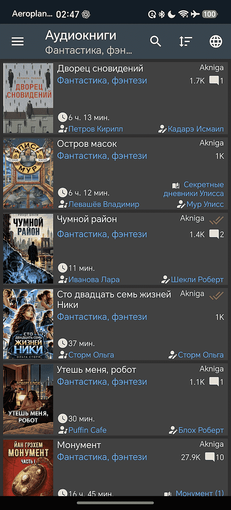
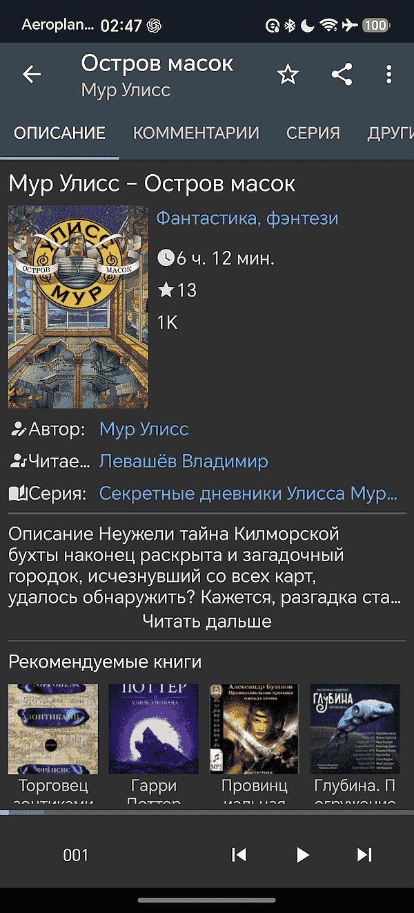
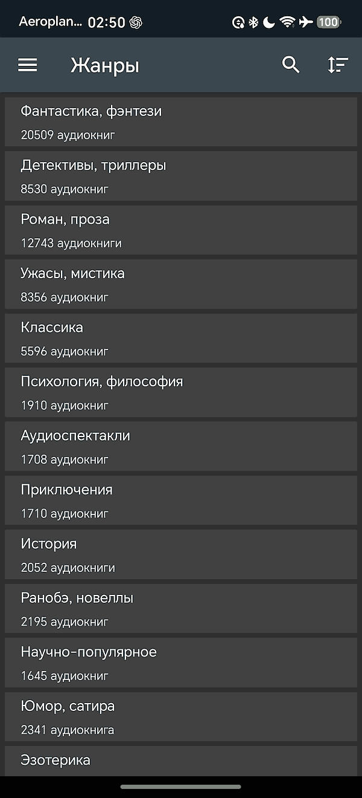
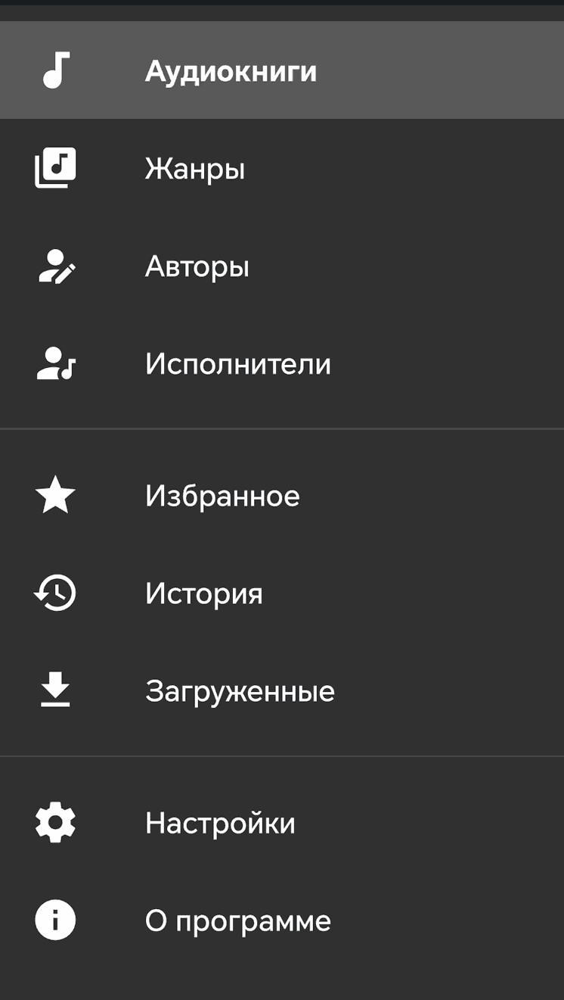
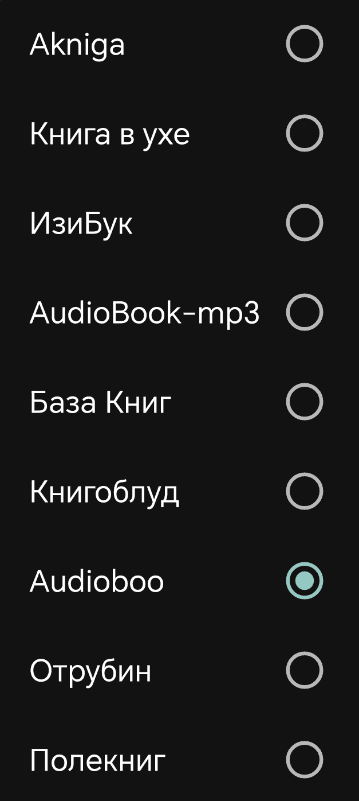
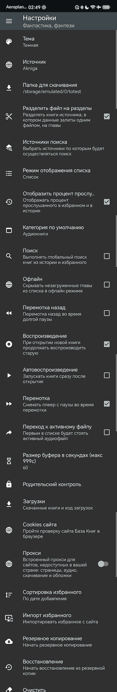

# AudioBooks

**English** · [Русский](readme.ru.md)

**Make room for books in your everyday life.** AudioBooks is an Android app for discovering and listening to audiobooks from several online catalogs. Enjoy a story on your commute, download a book before a trip, or fall asleep listening with a sleep timer.

The idea is simple: bring book discovery, a personal library, and comfortable listening together in one place. Browse classics, science fiction, mysteries, nonfiction, and children's stories, then pick up where you left off.

[Download & discussion on 4PDA](https://4pda.to/forum/index.php?showtopic=978445) · [Watch on YouTube](https://www.youtube.com/watch?v=MlqR32Finf0) · [Report an issue](https://github.com/korvin2000/AudioBooks/issues)

## What you can do

- **Find your next book.** Browse by genre, author, or narrator; search across your chosen sources; explore series and recommendations where available.
- **Listen online or offline.** Stream a book or download chapters in advance. Manage downloads and see which books are fully or partly saved.
- **Keep your place.** Resume listening from your saved position, revisit your history, and keep books in favorites.
- **Listen at your own pace.** Adjust playback speed, skip back 10 seconds or forward 30 seconds, and use background playback.
- **Wind down comfortably.** Set a sleep timer and adjust the sound with the equalizer.
- **Make it yours.** Choose a light, dark, or black theme, change the book list layout, set parental controls, and back up or restore app data.

### Book sources

Choose from **Akniga, Книга в ухе, ИзиБук, AudioBook-mp3, База Книг, Книгоблуд, Audioboo, Отрубин, and Полекниг**. Select the browsing source in **Settings → Source** (`Настройки → Источник`) and choose which catalogs to search under **Search sources** (`Источники поиска`).

Books and catalog details come from the selected websites. Availability, recommendations, and other features can vary by source and network access.

## Screenshots

The app interface shown below is in Russian. Select an image to view it at full size.

<table>
  <tr>
    <th>Book catalog</th>
    <th>Book details & player</th>
    <th>Genres</th>
  </tr>
  <tr>
    <td></td>
    <td></td>
    <td></td>
  </tr>
</table>

More screenshots: navigation, sources, and settings

<table>
  <tr>
    <th>Main menu</th>
    <th>Source selection</th>
    <th>Settings</th>
  </tr>
  <tr>
    <td valign="top"></td>
    <td valign="top"></td>
    <td valign="top"></td>
  </tr>
</table>

## Requirements

- An Android phone or tablet running **Android 7.0 or later**.
- An internet connection for browsing, streaming, and downloading books.
- Enough free storage for the chapters you want to keep offline.

**App language:** Russian. The English README is a guide to the app; menu names are also given in Russian where useful.

## Install

1. Open the [AudioBooks thread on 4PDA](https://4pda.to/forum/index.php?showtopic=978445) and find the APK in the first post's download section (`Скачать`).
2. Download the APK to your Android device and open it.
3. If Android asks, allow installation from the browser or file manager you used, then complete the installation.
4. Launch **AudioBooks** and choose a source in **Settings → Source** (`Настройки → Источник`).

An older release is also listed on [RuStore](https://apps.rustore.ru/app/com.fanok.audiobooks). Check its version before installing; use the 4PDA thread above for release information.

## Start listening

1. Browse **Audiobooks** (`Аудиокниги`) or **Genres** (`Жанры`), or search for a title, author, or narrator.
2. Open a book to read its description and start playback. Tap the star to add it to **Favorites** (`Избранное`).
3. For offline listening, download the chapters you need while connected, wait for them to finish, and open the book from **Downloaded** (`Загруженные`). The **Offline** (`Офлайн`) setting hides chapters that have not been downloaded.
4. Return through **History** (`История`) to continue listening from your saved position.

## Help & feedback

- **Questions and community:** [4PDA discussion](https://4pda.to/forum/index.php?showtopic=978445).
- **Video introduction:** [YouTube](https://www.youtube.com/watch?v=MlqR32Finf0).
- **Bugs and ideas:** [GitHub Issues](https://github.com/korvin2000/AudioBooks/issues). For a playback or download problem, include your app version, Android version, source, book link, and steps to reproduce it.
- **Contact the app developer:** use **About → Write to the author** (`О программе → Написать автору`) in the app.

If a catalog will not load, check your connection and try another source. If playback stops when the screen turns off, check the app's battery optimization setting. Before changing devices or reinstalling, use **Settings → Backup** (`Настройки → Резервное копирование`); save downloaded audio separately.

## Contributing

Bug reports, clearer instructions, translation improvements, and focused pull requests are welcome. For larger changes, open an issue first to discuss the approach. Please keep the English and Russian READMEs in sync.

For developers

The Android app lives in `app/`: Java code under `app/src/main/java`, screens and text under `app/src/main/res`, and tests under `app/src/test` and `app/src/androidTest`.

To build from source, open the project in Android Studio with **JDK 17** and **Android SDK 36**, let Gradle sync, and run the `app` module on an Android 7.0+ device or emulator. A debug APK can also be built with `./gradlew :app:assembleDebug` (`.\gradlew.bat :app:assembleDebug` on Windows). Release signing uses a local `keystore.properties`; see [the example](keystore.properties.example).

[Build and debugging notes](docs/howto.md) contain a detailed record of an earlier local setup; use the current Gradle files for configuration values.

**Original app developer:** fanok.inc (fanok1). A project license file has not yet been included in this repository.

